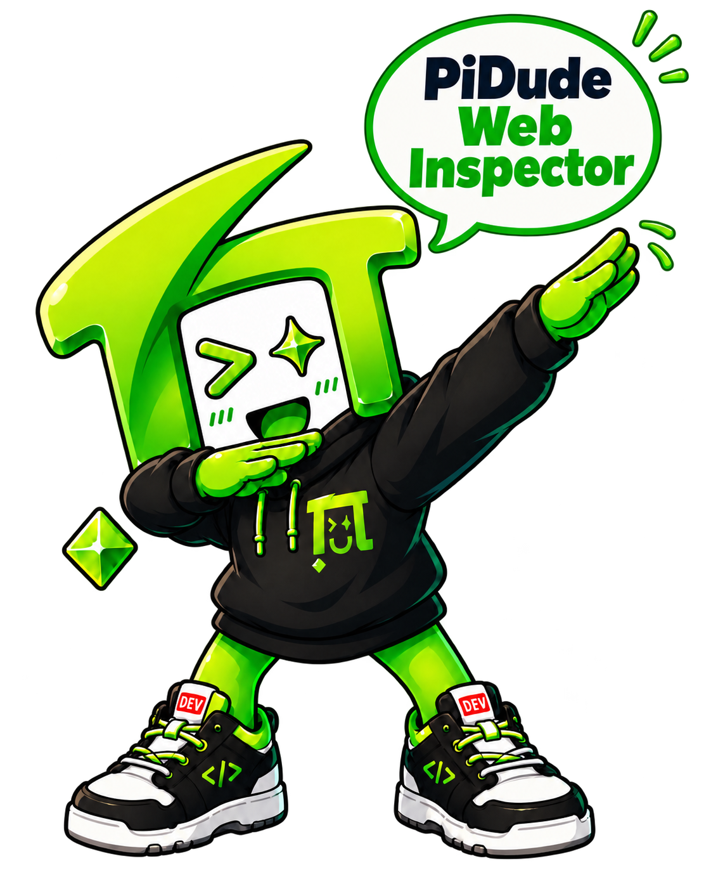
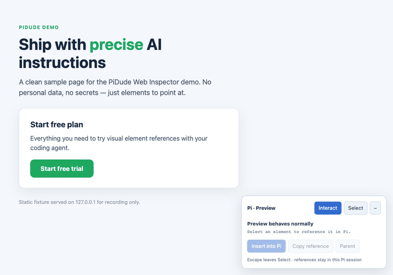

<p align="center">
  <a href="https://pidude.dev">
    
  </a>
</p>

<p align="center">Built at <a href="https://pidude.dev">PiDude</a>, born from real developer–agent collaboration challenges while building the PiDude website.</p>

<p align="center">
  <a href="https://buymeacoffee.com/bd87st4zrgh">
    
  </a>
</p>

# PiDude Web Inspector

**Point to the element. Give the instruction.**

PiDude Web Inspector helps developers give AI coding agents precise visual context. Select an element in your local web preview and insert its reference into Pi, so your agent can identify the intended target without repeated explanations.

It bridges the gap between what a developer sees in a browser and what an AI coding agent receives in a prompt: select an element, describe the change you want, and insert its reference directly into Pi. The agent receives focused element metadata alongside your instruction, helping it understand exactly what you mean.

No Pi fork, browser extension, or application code changes are required.

## Demo



The real picker flow: switch to **Select**, hover, click, **Parent** to target a bigger container, then **Insert into Pi**. The alias `@element_1` lands in Pi's editor at your cursor; only the tag is visible in chat while the element's metadata rides along to the model — exactly as described in [Quick Start](#quick-start).

A typical instruction then looks like:

```text
Make @element_1 wider and align its label to the left. Keep the existing colors and typography.
```

Want a full end-to-end clip (open → select → insert → agent applies the change)? The shot list and acceptance checklist live in [docs/DEMO.md](docs/DEMO.md).

## Why We Built It

PiDude Web Inspector grew out of a real problem while designing the PiDude website: the developer and Pi Agent sometimes interpreted the same instruction differently.

"Change this button" or "adjust that section" could point to the wrong element, leading to repeated explanations, unnecessary context, and edits that missed the intended target.

We built this tool to make that handoff explicit. Instead of describing an element's location from scratch, developers select it in the preview and pass a structured reference — with its metadata — straight into the prompt, so both sides point at the same thing.

What that buys you:

- Clearer developer–agent communication.
- More focused context handoffs.
- Less ambiguity and repeated clarification.
- Designed for more efficient token use; actual savings vary and have not been benchmarked.

## Installation

**Requirements:** Node.js 22+, a Pi version with `ctx.ui.pasteToEditor()` support (tested on 0.87.0–1.1.0), and a local graphical desktop.

### Option A: try it from a clone

```sh
git clone <this repository>
cd pidude-web-inspector
npm install
npx playwright install chromium
pi -e ./src/index.ts
```

### Option B: agent-assisted install of the release ZIP

Extract the release ZIP anywhere, then ask Pi:

```text
Read /path/to/pidude-web-inspector/INSTALL.md and install this extension
for all my Pi projects. Copy it into my Pi extensions directory so I can
delete the extracted download afterward. Check compatibility first.
```

Pi installs a self-contained copy at `~/.pi/agent/extensions/pidude-web-inspector/` (or your configured agent directory), where Pi auto-discovers it. After `/reload` and `/preview help` work, the ZIP and extracted folder can be deleted. See [INSTALL.md](INSTALL.md) for the complete setup, upgrade, and uninstall guide.

### Option C: register a working checkout

For a checkout you keep editing in place:

```sh
pi install -l /absolute/path/to/pidude-web-inspector
```

Then `/reload` in an existing Pi session, or restart Pi. This keeps a reference to the checkout — the folder must remain in place. Do not combine it with Option B for the same extension, or it may load twice.

## Quick Start

1. Start your app's dev server (Next.js, Vite, etc.), then run `/preview http://localhost:5173` in Pi (any loopback HTTP(S) URL). A dedicated Chromium window opens with a small picker panel.
2. Type your draft in Pi and leave the caret where you want the reference.
3. In the browser, switch the panel from **Interact** to **Select**, then click the element you mean. Use **Parent** to walk up to a bigger container.
4. Click **Insert into Pi** — an alias like `@element_1` lands in your draft. (**Copy reference** puts it on the clipboard instead.)
5. Write your instruction and send it:

   ```text
   Make @element_1 wider and align its label to the left. Keep the existing colors and typography.
   ```

The reference supplies element metadata — its selector, tag name, visible text, accessibility attributes, and page path — so your instruction has a concrete target. Only the tags are visible in chat; the metadata is attached to the request-time copy of your message.

`/preview help` shows this guide inside Pi at any time.

## Features

- **Visual element selection:** Pick elements directly from a running local preview.
- **Interact and Select modes:** Use the page normally, or select an element for your next instruction.
- **Parent selection:** Move up to a containing element when you need to target a larger section.
- **Direct prompt insertion:** Insert references into Pi without manually copying selectors.
- **Focused context handoff:** Send relevant element metadata rather than the entire page.
- **Session-scoped references:** References survive navigation, browser closure, and session reload or resume; `/preview status` shows connection state and the saved count.
- **Keyboard controls:** `Escape` exits selection mode; `Enter` or `Space` selects the focused element. The panel minimizes to a corner button and restores automatically when you select something.

## Commands

| Command | Description |
|---|---|
| `/preview URL` | Open a separate Chromium preview window. Supports `localhost`, `127.0.0.1`, and `[::1]` HTTP(S) URLs only. |
| `/preview help` (`-h`, `--help`) | Show usage instructions and a step-by-step guide. |
| `/preview status` | Show connection status and the number of saved references. |
| `/preview close` | Close the preview browser while keeping references. |
| `/preview clear` | Close the preview browser and clear saved references. Numbers are never reused. |

Notes:

- Up to 12 distinct references per prompt, 999 per session. Unknown references are rejected with an explanation before the prompt is sent.
- References belong to the paired Pi session and branch. Copying `@element_1` into a different session does not transfer its meaning.

## Privacy and Context Boundaries

The preview uses a separate, temporary browser profile rather than your everyday browser profile. The extension has no access to your regular browser profile, cookies, or login state, and it runs no local network bridge — the browser connects to Pi through a source-checked Playwright binding.

The inspector excludes form-value capture, editable content, script/style content, and hidden content. It does not capture full-page HTML, cookies, browser storage, or URL query strings.

Selected element text and metadata are included in the context sent to your configured model when you submit a prompt. Metadata is treated as untrusted page content, not as instructions. It is stored locally in Pi's session files; storing it hides it from chat but does not encrypt it. `/preview clear` removes the active references' meanings and does not erase historical session records or data already sent to a model.

References are deduplicated, with limits of 12 references per prompt and a 16,000-character reference-context budget per request.

Select only content you intend to share: page text and labels can still contain sensitive information.

## Limitations

PiDude Web Inspector provides precise references for your coding agent. It does not edit your application by itself and does not guarantee that an agent will make the correct change.

This release supports local previews only (`localhost`, `127.0.0.1`, `[::1]`). Additional v0.1 limitations:

- Pi's terminal UI only; RPC/web hosts need their own editor integration.
- A dedicated Chromium window — it does not attach to an already-open browser tab. The browser binary must be installed explicitly (`npx playwright install chromium`); the extension never auto-downloads it.
- Selects top-level light DOM. Iframe containers and shadow hosts can be referenced, but not their internal elements — select the containing host/frame instead.
- Native top-layer dialogs may cover the picker; canvas internals cannot be selected as DOM elements.
- Clipboard permissions vary. If copying fails, the panel shows the registered alias for manual copying.
- Snapshot metadata survives rerenders but can become stale; reselect after substantial page changes.
- A blocking Pi extension dialog prevents direct insertion; close it or use **Copy reference**.

## Development and tests

```sh
npm run typecheck
npm test                 # core and fake-host integration
npm run test:browser     # headless Chromium integration
npm run check            # all of the above
```

Browser tests run an ephemeral loopback fixture and write `artifacts/picker.png` (git-ignored). No model calls are made.

Further reading: [specification](docs/PIDUDE-WEB-INSPECTOR-SPEC.md) · [validation report](docs/VALIDATION.md) · [original builder specification](docs/PREVIEW-ELEMENT-SELECTION-SPEC.md)

## License

[MIT](LICENSE) © 2026 [pidude.dev](https://pidude.dev)

---

> Built at PiDude. Shared with developers who want clearer communication with their AI agents.

<p align="center">
  
</p>
